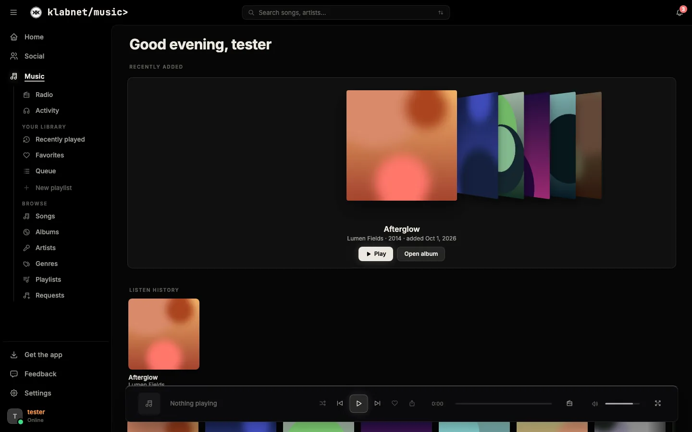
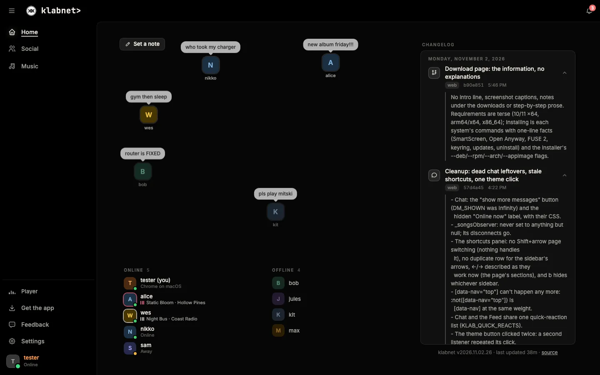
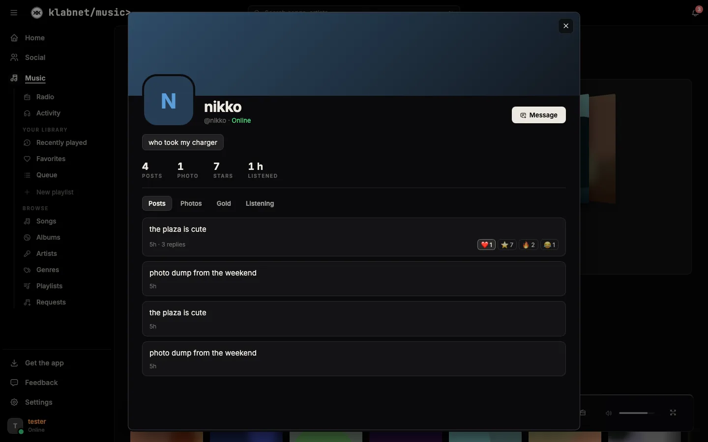
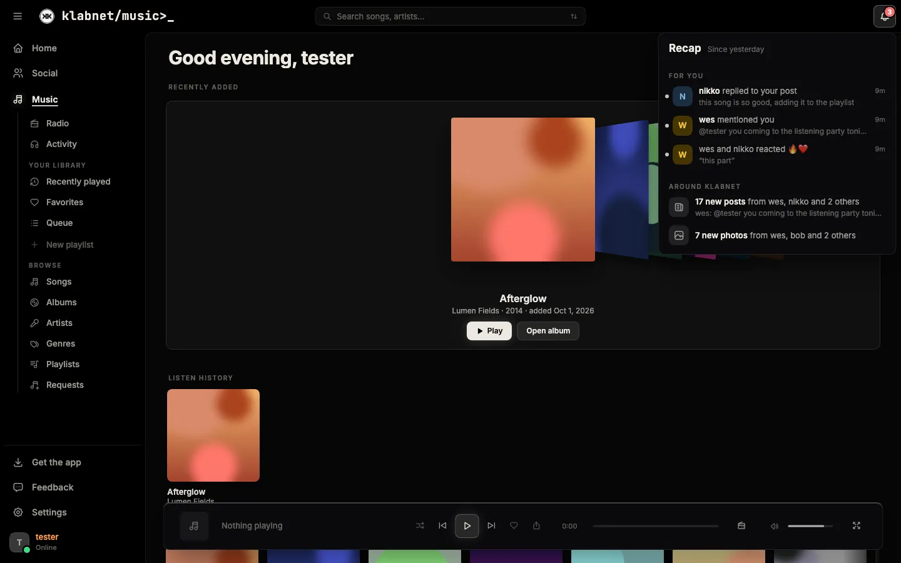
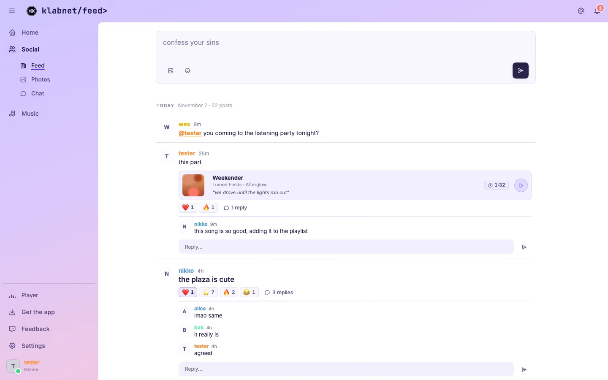
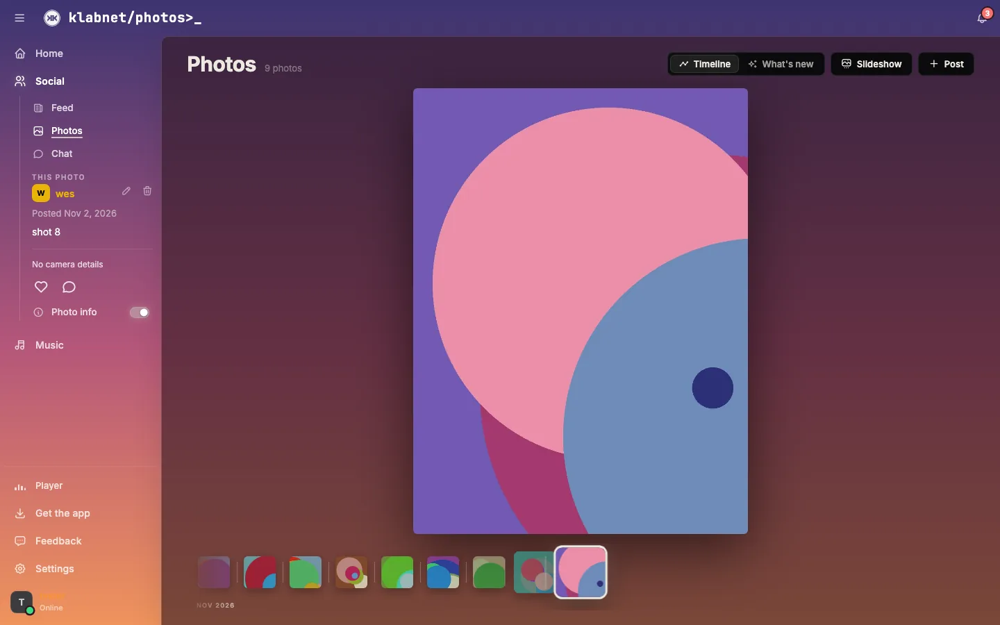

# klabnet

The KLAB homelab's own app: music, chat, a feed, photos and a radio for a group of friends, as one site at [`user.klab.gg`](https://user.klab.gg) (staged at `staging.klab.gg`, both behind Authentik). The same site is the inside of [klabnet-desktop](https://git.klab.gg/xvoltzz/klabnet-desktop) (Windows, macOS, Linux) and the phone apps.



## What's in it

**Home.** Who's online and who isn't, what they're playing, and everyone's notes floating about. Beside it, the changelog: the newest commits to this repo and the API, with their whole messages.



**Music**, on [Navidrome](https://www.navidrome.org/) over the Subsonic API:
- Cover Flow of new albums, and browsing with an A–Z rail, filters and a virtual list of the whole library.
- Playlists with covers that other people can see, save and add to.
- Synced lyrics and a full-screen player, with high-res art looked up from iTunes, Deezer and the Cover Art Archive (display only).
- Requests, and an Activity page of who's listening to what.
- **One player across devices**, like Spotify: one device plays and the rest are its remote. Play here moves the sound.
- **Radio**, GTA-style: anyone uploads a station as one long mix, and everyone tuned in hears the same moment, synced to the API's clock. Tune it on an FM dial in the player.

**Social** is Feed, Photos and Chat on one page.
- **Feed**: posts with markdown, pictures, GIFs, a song (from a moment: "listen from 1:32", with the lyric), @mentions, replies and reactions.
- **Photos**: a timeline with a filmstrip scrubber, EXIF, tags, a song per post and a slideshow.
- **Chat** is [Matrix](https://matrix.org/) (Synapse): channels and DMs, reactions, listen-along, and muting a conversation (a push rule).
- **Voice channels** on a self-hosted [LiveKit](https://livekit.io/): drop in like Discord, with push to talk.
- Custom `:emoji:` and a picker next to its button. Star anything; five ⭐ turns it gold.

**Profiles**: someone's banner, note, bio and what they're playing; their posts, photos and gold moments; and what they listen to.



**The recap** (the bell): replies, mentions, reactions and messages for you, and what's been posted, shared, featured or put on air since you last looked.



**Looks.** Dark, Light (a coloured frame round a white page), and Sky, where the window is the sky at the local time and the app is glass over it. Also OLED black and a Performance mode. In the desktop app it looks native on each system, with its own look on Linux.

| Light | Sky (sunset) |
|---|---|
|  |  |

It's made for a mouse and keyboard: `/` searches, Tab changes page, ←/→ and ↑/↓ walk the sidebar, `b` hides it, `?` lists the rest. The prompt in the title bar is a tiny shell (`cd`, `ls`, `help`). Phones get their own layout.

## How it's built

- **No build step.** `index.html` loads `css/app.css` and `js/NN-*.js` as classic deferred scripts that share globals, in order; later files wrap earlier functions. Vanilla JS, no framework.
- **Versioned assets.** Every JS/CSS URL carries `?v=<KLABNET_VERSION>`, and a service worker serves them cache-first. Bump the version on every change (`./check-version.sh` checks it).
- **Icons** are a subset of [Tabler](https://tabler.io/icons) built from what's used: `scripts/build-icons.py`.
- **Backend:** [klabnet-api](https://git.klab.gg/xvoltzz/klabnet-api), FastAPI + SQLite. It handles prefs, presence, posts, photos, playlists, the play session, radio, voice tokens, emoji, the recap, feedback and the changelog.
- **Auth:** Authentik `forward_auth` at Caddy. The site and API trust the identity headers Caddy adds.
- **Serving:** Caddy `file_server` off a checkout. Caddy forwards only a fixed list of `/api` prefixes, so new routes ride existing ones.
- `desktop/` is the download page for the desktop app (user.klab.gg/desktop/).

```
index.html         the page
css/app.css        everything's styles, in dated blocks
css/icons.css      the icon subset (generated)
js/00-util.js …    the app, in load order
js/vendor/         LiveKit's client and the emoji data, fetched when first needed
sw.js              the service worker
desktop/           the desktop app's download page
docs/shots/        these screenshots
CLAUDE.md          how each part works and why; read it before changing one
```

## Deploying

Push to deploy. Four remotes:

| Remote | Where | What for |
|---|---|---|
| `origin` | Gitea, `git.klab.gg` | source of truth |
| `github` | GitHub | mirror |
| `staging` | `/home/klab/staging-web` → `staging.klab.gg` | testing with the real Authentik and API |
| `prod` | `/home/klab/web` → `user.klab.gg` | live |

`staging` and `prod` are bare repos on the web host. A `post-receive` hook checks the pushed commit out into the served directory:

```bash
git --work-tree=/home/klab/web --git-dir=/home/klab/repos/klabnet-web.git checkout -f main
```

```bash
git push staging main   # try it
git push prod main      # ship it
git push origin main && git push github main
```

To roll back, `git revert <hash>` and push `prod`.

## Running it locally

Everything real is behind Authentik, so local runs use a mock: a static server for this repo, klabnet-api behind a small wrapper that takes the user from a header in place of Authentik, and a fake Navidrome. The pages are driven and screenshotted in headless Chrome. See CLAUDE.md, "Testing without the real site".
